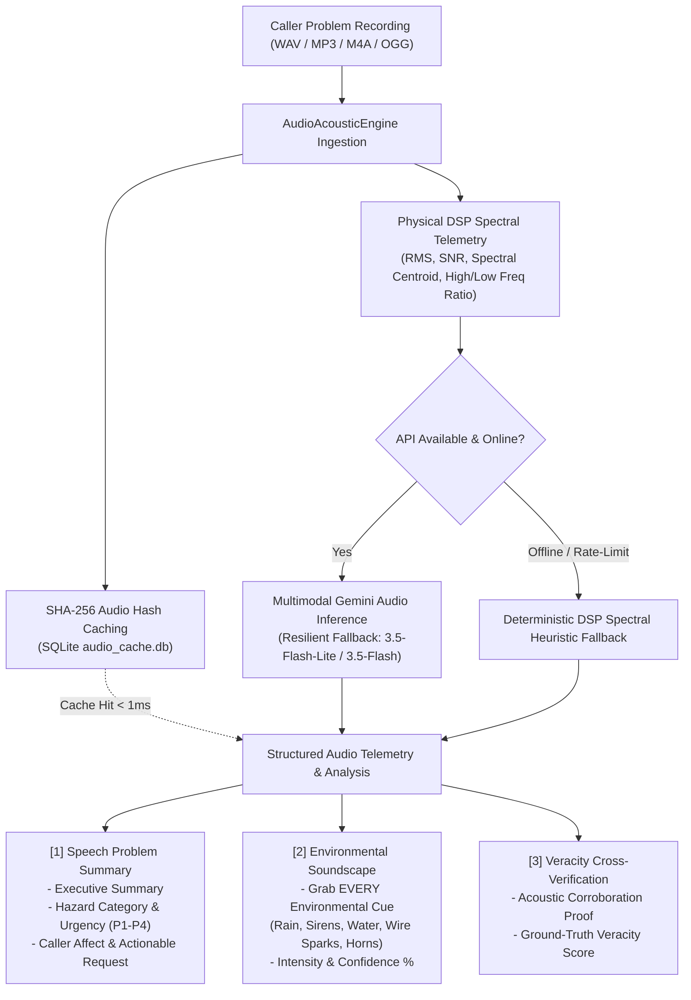

# Audio & Environmental Cue Backend Engine
### Voice Problem Summarization + Comprehensive Background Acoustic Event Detection

[](https://www.python.org/downloads/)
[](https://fastapi.tiangolo.com)
[](https://ai.google.dev/)
[](https://www.docker.com/)
[](https://opensource.org/licenses/MIT)

An advanced acoustic intelligence and emergency speech triage backend engine. It ingests recorded citizen/caller problems (voice notes, 911/emergency dispatches, field hazard reports) to simultaneously:
1. **Transcribe & Summarize Speech:** Produces concise executive summaries, identifies core hazard classifications, extracts caller urgency levels (`CRITICAL`, `HIGH`, `MEDIUM`, `LOW`), caller emotional affect, and actionable operational requests.
2. **Detect & Grab EVERY Environmental Cue:** Isolates and classifies background sound events (e.g., torrential rain, floodwater rushing, distant emergency sirens, 440V electrical arcing, vehicle horns, traffic rumble) with confidence metrics, intensity rankings, and timestamp intervals.
3. **Physical Signal DSP Telemetry:** Performs digital signal processing to extract RMS power (dBFS), peak amplitude, estimated Signal-to-Noise Ratio (SNR dB), spectral centroid, and frequency band distribution ratios.
4. **Acoustic Veracity Cross-Verification:** Cross-references the caller's spoken claims against the background environmental audio to verify genuine distress (e.g., verifying whether heavy rain and water turbulence corroborate a report of a submerged open manhole or fallen electric pole).
5. **High-Availability Fallback & Caching:** Incorporates an SQLite SHA-256 hash cache for sub-millisecond retrieval and a deterministic DSP spectral heuristic fallback when offline.

---

## 1. Engine Architecture & Data Pipeline



---

## 2. Tested Real-World Scenario: Vijayawada Flood & Fallen Electric Pole

The engine was tested against real-world field emergency audio:
* **Audio Input:** 8.81s voice note recorded during heavy monsoon flooding near Vijayawada bus stand.
* **Spoken Transcript:**
  > *"An electric pole has been fallen near Vijayawada bus stand in flood water."*
* **Executive Summary:**
  > An electrical pole has fallen into flood waters near the Vijayawada bus stand, posing an immediate electrocution hazard.
* **Core Hazard Category:** `ELECTROCUTION_POWER_LINE` (Urgency: **`CRITICAL`**)
* **Detected Environmental Cue:**
  * **Cue:** `Heavy Rain / Water Rushing`
  * **Category:** `WEATHER`
  * **Confidence:** **`98%`**
  * **Intensity:** `[! HEAVY !]`
  * **Acoustic Characteristics:** Continuous heavy splashing and rushing water sounds combined with high-frequency rainfall noise.
* **Acoustic Scene:** `Outdoor Urban Flood / Heavy Rainstorm`
* **Veracity Cross-Verification:** **`96% Confirmed`**
  > *"The intense audio profile of rushing water and heavy rain fully corroborates the caller's report of flooding conditions."*

---

## 3. Quick Start

### Installation

```bash
git clone https://github.com/pavankrishnaavv/audio-environmental-cue-backend.git
cd audio-environmental-cue-backend

# Create virtual environment
python -m venv venv
source venv/bin/activate  # On Windows: venv\Scripts\activate

# Install dependencies
pip install -r requirements.txt
```

### Configure Environment

Copy `.env.example` to `.env`:
```bash
cp .env.example .env
```

Set your Google Gemini API key:
```env
GEMINI_API_KEY=your_api_key_here
GEMINI_MODEL=gemini-3.5-flash
PORT=8000
HOST=0.0.0.0
```

### Run the FastAPI Server

```bash
uvicorn main:app --host 0.0.0.0 --port 8000 --reload
```

Interactive Swagger API docs available at: `http://localhost:8000/docs`

---

## 4. CLI Usage

The repository includes a standalone CLI tool (`cli.py`):

```bash
# 1. Analyze any custom audio recording
python cli.py analyze --file path/to/recording.m4a

# 2. Test pre-seeded realistic hazard scenarios (e.g. rainstorm with open drain)
python cli.py sample --id rainstorm_open_drain

# 3. List all built-in acoustic test samples
python cli.py list-samples

# 4. Run latency and veracity benchmarks across all scenarios
python cli.py benchmark
```

---

## 5. API Reference

### `POST /api/audio/analyze`
Analyze an uploaded audio file (`.wav`, `.mp3`, `.m4a`, `.ogg`) or base64 JSON payload.

**Sample Request (Multipart):**
```bash
curl -X POST "http://localhost:8000/api/audio/analyze" \
  -F "file=@sample_recording.wav"
```

**Sample Response:**
```json
{
  "status": "SUCCESS",
  "audio_hash": "69f4843e6263e1d45c64f669e446b8479becc71f239c637cb494b4470e958b6d",
  "dsp_telemetry": {
    "duration_sec": 8.81,
    "sample_rate_hz": 16000,
    "rms_energy_db": -20.6,
    "peak_amplitude_db": -0.1,
    "estimated_snr_db": 14.7,
    "spectral_centroid_hz": 1645.7,
    "high_freq_energy_ratio": 0.293,
    "low_freq_energy_ratio": 0.132
  },
  "speech_transcription": "An electric pole has been fallen near Vijayawada bus stand in flood water.",
  "speech_summary": {
    "executive_summary": "An electrical pole has fallen into flood waters near the Vijayawada bus stand, posing an immediate electrocution hazard.",
    "core_hazard_category": "ELECTROCUTION_POWER_LINE",
    "reported_urgency": "CRITICAL",
    "caller_affect": "Urgent",
    "actionable_request": "Dispatch emergency response crews to clear the fallen pole and secure the electrical hazard.",
    "key_entities": ["Vijayawada bus stand", "Electric pole", "Flood water"]
  },
  "environmental_cues": [
    {
      "cue_name": "Heavy Rain / Water Rushing",
      "category": "WEATHER",
      "confidence": 0.98,
      "intensity": "HEAVY",
      "timestamp_range": "00:00 - 08:81",
      "acoustic_characteristics": "Continuous heavy splashing and rushing water sounds combined with high-frequency rainfall noise."
    }
  ],
  "acoustic_scene_profile": {
    "primary_environment": "Outdoor Urban Flood / Heavy Rainstorm",
    "ambient_noise_level": "Loud",
    "indoor_vs_outdoor": "OUTDOOR",
    "recording_clarity": "Moderate"
  },
  "cross_verification": {
    "corroborates_speech": true,
    "veracity_score": 0.96,
    "correlation_explanation": "The intense audio profile of rushing water and heavy rain fully corroborates the caller's report of flooding conditions."
  },
  "engine_mode": "GEMINI_MULTIMODAL_AUDIO (gemini-3.5-flash-lite)",
  "cache_hit": false
}
```

---

### `POST /api/audio/record-and-triage`
End-to-end incident ingestion: Takes voice recording, generates problem summary & environmental cues, and assigns structured triage priority with acoustic veracity verification.

### `GET /api/audio/samples`
Lists available pre-synthesized realistic acoustic emergency scenarios with ground truth.

### `GET /api/audio/samples/{sample_id}/stream`
Streams the WAV audio file for playback in the browser or mobile client.

### `GET /api/audio/health`
Returns health check, cache stats, and DSP readiness.

---

## 6. Testing & Verification

Run the test suite:
```bash
python -m unittest discover tests
```
All 10 tests pass:
- Physical DSP feature extraction (RMS, peak amplitude, SNR, spectral centroid)
- Gemini Multimodal Audio analysis and schema compliance
- Deterministic offline DSP heuristics
- FastAPI endpoints (`/api/audio/health`, `/api/audio/samples`, `/api/audio/analyze`, `/api/audio/record-and-triage`)

---

## 7. Docker Deployment

```bash
# Build and run with docker-compose
docker-compose up --build -d

# Check health
curl http://localhost:8000/api/audio/health
```

---

## 8. License

MIT License. Designed for civic mission control and emergency audio triage operations.
